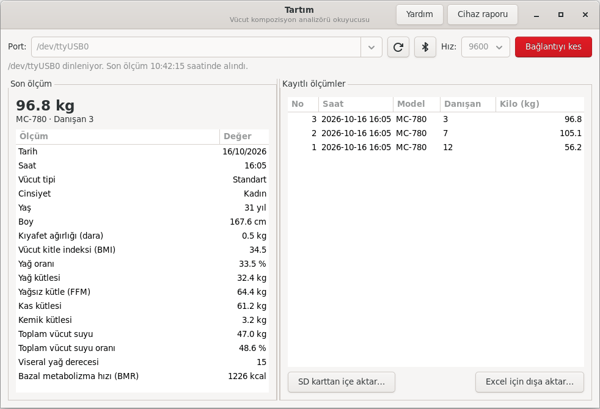

# tartim

Türkçe · **[English](README.md)**

Pardus ve diğer GNU/Linux sistemlerinde **vücut kompozisyon analizörlerinden**
(Tanita uyumlu cihazlar) ölçüm almak için açık kaynak okuyucu.

Üreticinin bilgisayar yazılımı yalnızca Windows'ta çalışıyor. `tartim` cihazın
seri port (RS-232 / USB) ya da Bluetooth üzerinden gönderdiği ölçümü okur,
çözer ve yerel bir veritabanına kaydeder. SD karttaki CSV dosyalarını da içe
aktarabilir.

> **Durum: erken geliştirme.** Veri biçimi kılavuzlara ve topluluk notlarına
> dayanıyor, henüz gerçek bir cihazla doğrulanmadı. Ayrıntılar (İngilizce):
> [docs/PROTOCOL.md](docs/PROTOCOL.md)

Tanita, TANITA Corporation'ın tescilli markasıdır. Bu proje Tanita ile bağlantılı
değildir.

Arayüz **Türkçe** ve **İngilizce**dir; sistemin diline göre açılır
(`TARTIM_LANG=tr` ya da `TARTIM_LANG=en` ile değiştirilebilir).

## Kurulum (Pardus 23 / 25)

Uçbirimde tek komut:

```sh
curl -fsSL https://raw.githubusercontent.com/muratGursel/tartim/main/install.sh | sudo sh
```

Ya da [Sürümler](https://github.com/muratGursel/tartim/releases) sayfasından
`tartim_*_all.deb` dosyasını indirip kurun:

```sh
sudo apt install ./tartim_*_all.deb
```

Paket, oturum açmış kullanıcıya USB-seri portlara erişim izni veren bir udev
kuralı da kurar; `dialout` grubuna eklenmeniz gerekmez. RS-232 portu doğrudan
anakartta ise (`/dev/ttyS*`) `sudo usermod -aG dialout $USER` gerekir.

Geliştirme için kaynaktan çalıştırmak: `sudo apt install python3-serial
python3-gi gir1.2-gtk-3.0` ve depo klasöründe `python3 -m tartim`.

## Masaüstü arayüzü

Kurulumdan sonra uygulama menüsünde **Tartım** adıyla görünür; uçbirimden
`tartim-arayuz` ile de açılır.



Adım adım anlatım için: **[Kullanım kılavuzu](docs/KULLANIM.md)**
([PDF olarak indir](docs/Tartim-Kullanim-Kilavuzu.pdf))

1. Tartının portunu seçip **Bağlan**'a basın.
2. Cihazda ölçüm yapın; sonuç solda görünür ve otomatik kaydedilir.
3. Geçmiş ölçümler sağda listelenir. **SD karttan içe aktar** ve **Excel için
   dışa aktar** düğmeleri buradadır.
4. **Cihaz raporu** düğmesi, geliştiricilere gönderilecek raporu birkaç adımda
   hazırlar.

## Bluetooth

Port alanının yanındaki Bluetooth düğmesi yakındaki tartıları arar
(komut satırında: `tartim bluetooth`).

- **Standart Bluetooth tartılar** (Weight Scale / Body Composition servisi
  olanlar): listeden seçip **Bağlan**'a basın, ölçümler canlı gelir.
- **Klasik Bluetooth seri cihazlar**: önce sistem ayarlarından eşleştirin
  (PIN genellikle 0000 ya da 1234), sonra listeden seçip bağlanın.
- **Üreticiye özel protokoller** (ör. Tartı FAST): henüz doğrudan
  okunamıyor. Bir **cihaz raporu** gönderirseniz destek ekleyebiliriz.

## Komut satırı

Komutların İngilizce adları da vardır (`tartim listen`, `tartim import` …);
aşağıdaki Türkçe adlar da çalışmaya devam eder.

```sh
tartim portlar                         # bağlı seri portlar
tartim dinle --port /dev/ttyUSB0       # ölçümleri göster ve kaydet
tartim ice-aktar /media/$USER/SD/*.CSV # SD karttan içe aktar
tartim listele --son 10
tartim disa-aktar --cikti olcumler.csv # Excel / LibreOffice için
tartim ham --port /dev/ttyUSB0         # yeni cihaz için ham veri
```

Port ayarları: `--baud 9600 --parite N --veri-biti 8 --dur-biti 1` (varsayılan).

Ölçümler `~/.local/share/tartim/tartim.db` dosyasında saklanır. Dosya yalnızca
sizin okuyabileceğiniz izinlerle oluşturulur.

## Tartınız mı var? Cihaz raporu gönderin

Projenin gelişmesi için en çok ihtiyaç duyduğumuz şey farklı cihazlardan
gerçek ölçüm verisi. Tartıyı bilgisayara takın ve şunu çalıştırın:

```sh
tartim rapor          # ya da arayüzde "Cihaz raporu" düğmesi
```

Program yalnızca cihaz modelini ve ekranda gördüğünüz kiloyu sorar, portu
kendisi bulur. Siz ölçüm yaptığınızda gelen veriyi kaydeder ve bir
`tartim-report-MODEL-TARIH.json` dosyası oluşturur. Danışan numarası dosyaya
yazılmadan maskelenir. Ardından nasıl göndereceğinizi seçersiniz: proje
sunucusuna (hesap gerekmez),
[GitHub formuyla](https://github.com/muratGursel/tartim/issues/new?template=cihaz-raporu.yml)
ya da daha sonra (`tartim rapor-gonder DOSYA`).

- SD kart dosyası için: `tartim rapor --dosya /media/$USER/SD/20261016.CSV`
- Bluetooth'lu tartılar için: `tartim rapor --bluetooth` (ya da arayüzde
  "Cihaz raporu → Bluetooth ile…")
- Daha fazla bilgi vermek isterseniz: `tartim rapor --ayrintili` (cihaz
  ayarlarını, cihaza girilen boy/yaş/cinsiyeti ve ekrandaki tüm değerleri
  sorar; değerleri veriyle karşılaştırıp hangi alanın neye karşılık geldiğini
  gösterir)

Ölçümü kendinizle ya da bir test kişisiyle yapın; gerçek bir danışanın
ölçümünü göndermeyin.

## Cihaz olmadan deneme

```sh
socat -d -d pty,raw,echo=0,link=/tmp/tarti pty,raw,echo=0,link=/tmp/pc &
python3 -m tartim dinle --port /tmp/pc &
python3 -m tartim simule --port /tmp/tarti --adet 3
```

Simülatörün ürettiği değerler sentetiktir ve hiçbir kişiye ait değildir.

## Testler

```sh
python3 -m unittest -v
```

Seri port testi Linux'ta `socat` ve `python3-serial` kuruluysa çalışır.
Arayüz testi bir ekran ister; ekransız bir sunucuda GTK Broadway ile
çalıştırılabilir:
`broadwayd :5 & GDK_BACKEND=broadway BROADWAY_DISPLAY=:5 python3 -m unittest`

## Çeviriler

Kaynak metinler İngilizcedir; çeviriler [`tartim/locale/`](tartim/locale)
klasöründeki gettext `.po` dosyalarındadır ve açılışta bellekte derlenir, ayrı
bir derleme adımı gerekmez. Bir test, her metnin Türkçe çevirisi olduğunu ve
yer tutucuların eşleştiğini denetler.

## Rapor sunucusu

Kullanıcılar cihaz raporlarını GitHub hesabı olmadan, uygulamadan tek tıkla
gönderebilir. Raporlar `https://ldow.duckdns.org/tartim/report` adresindeki
küçük bir servis tarafından denetlenip özel bir depoya iletilir; GitHub
anahtarı yalnızca sunucuda durur. Kurulum ve güvenlik modeli (İngilizce):
[server/INSTALL.md](server/INSTALL.md). Gönderim isteğe bağlıdır; kurumlar
`TARTIM_REPORT_URL` ile kendi sunucularını verebilir ya da boş bırakarak
seçeneği kapatabilir.

## Kişisel veriler (KVKK)

Vücut ölçümleri sağlık verisidir ve KVKK'ya göre özel nitelikli kişisel veri
sayılır. Kurumunuzda kullanmadan önce açık rıza, erişim yetkisi ve saklama
süresi konularını veri sorumlunuzla netleştirin. Gerçek ölçüm kayıtlarını
hata bildirimlerine ya da bu depoya eklemeyin.

## Yol haritası

- [ ] Gerçek MC-780 / BC-418 cihazlarla alan kodlarını doğrulamak
- [ ] `CS` sağlama değerini doğrulamak
- [ ] Uzak kip: boy, yaş ve cinsiyetin bilgisayardan cihaza gönderilmesi
- [x] Masaüstü arayüzü (GTK)
- [ ] Danışan kaydı ve gelişim grafikleri
- [x] Bluetooth: standart BLE tartılar, klasik seri port, keşif raporu
- [ ] Tartı FAST protokolü (cihaz raporu bekleniyor)
- [ ] PDF ölçüm raporu
- [x] `.deb` paketi ve tek komutla kurulum
- [x] Türkçe ve İngilizce arayüz ve belgeler
- [ ] Pardus Mağazası'na başvuru
- [ ] Diğer markalar için eklenti yapısı

## Katkı

Elinizde bir tartı varsa en değerli katkı `tartim rapor` ile hazırlanan
dosyadır (yukarıya bakın). Protokol ayrıntıları: [docs/PROTOCOL.md](docs/PROTOCOL.md).

Paketi kaynaktan derlemek için: `sh packaging/build-deb.sh`

## Lisans

GPL-3.0-or-later. Bkz. [LICENSE](LICENSE).
