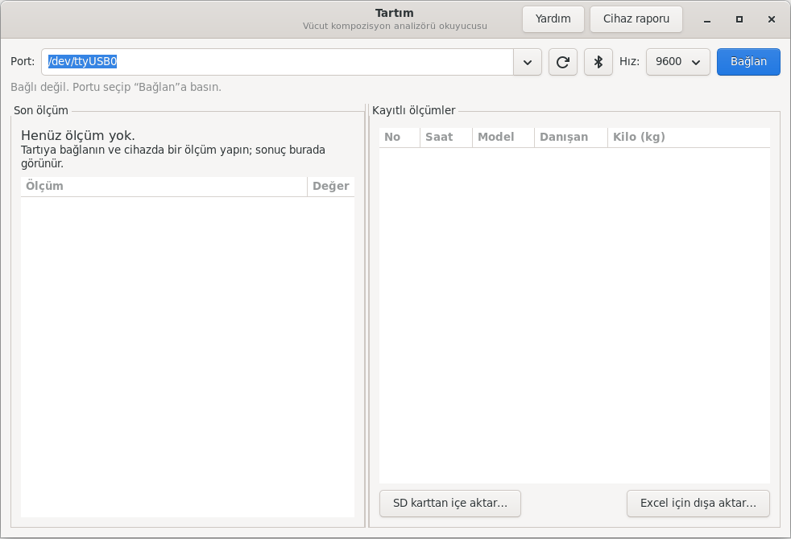
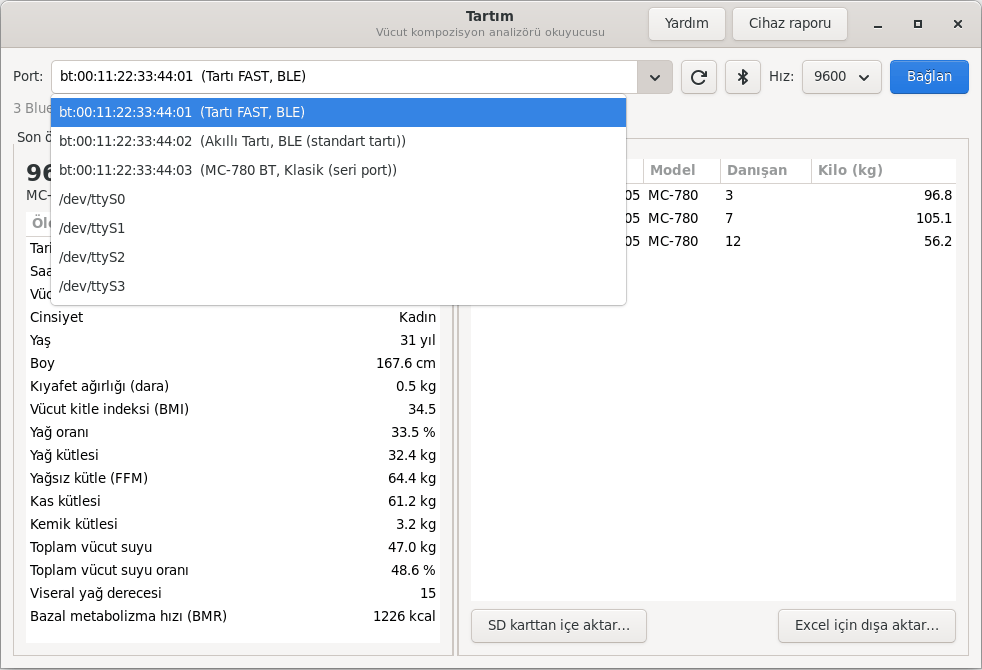
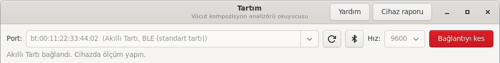
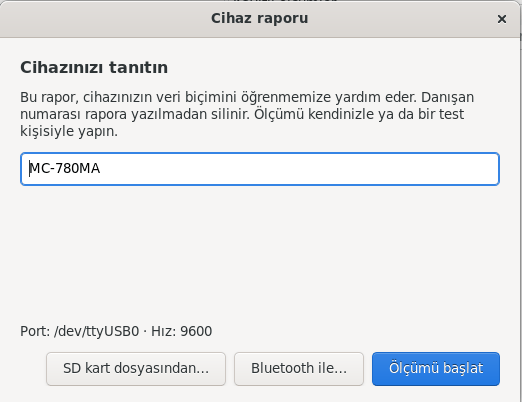
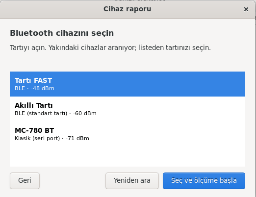
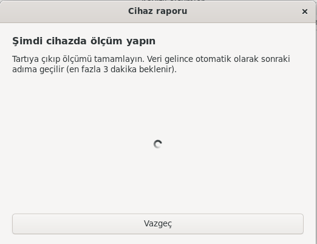
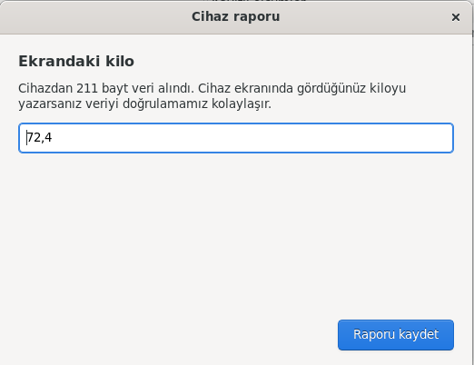
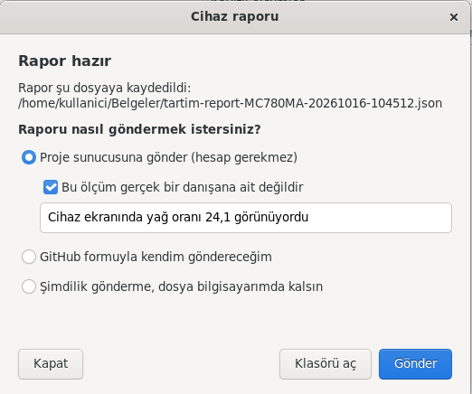
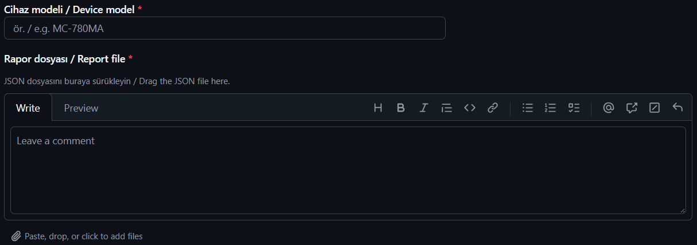

# Tartım Kullanım Kılavuzu

📄 **[Bu kılavuzu PDF olarak indirin](Tartim-Kullanim-Kilavuzu.pdf)** (yazdırmak için) · [English](USER_GUIDE.md)

> Kılavuzdaki ekran görüntülerinde örnek (sentetik) ölçümler ve örnek
> Bluetooth cihazları kullanılmıştır; hiçbiri gerçek bir kişiye ait değildir.

Bu kılavuz, Tartım uygulamasıyla vücut analiz cihazınızdan (tartıdan) ölçüm
almayı, ölçümleri saklamayı ve geliştiricilere cihaz raporu göndermeyi adım
adım anlatır. Bilgisayar bilgisi gerektirmez.

**İçindekiler**

1. [Kurulum](#1-kurulum)
2. [Uygulamayı açmak](#2-uygulamayı-açmak)
3. [Tartıyı kabloyla bağlamak](#3-tartıyı-kabloyla-bağlamak)
4. [Tartıyı Bluetooth ile bağlamak](#4-tartıyı-bluetooth-ile-bağlamak)
5. [Ölçüm almak](#5-ölçüm-almak)
6. [Geçmiş ölçümler, SD kart ve Excel](#6-geçmiş-ölçümler-sd-kart-ve-excel)
7. [Cihaz raporu hazırlamak ve göndermek](#7-cihaz-raporu-hazırlamak-ve-göndermek)
8. [Sorun giderme](#8-sorun-giderme)
9. [Kişisel verilerin korunması](#9-kişisel-verilerin-korunması)

---

## 1. Kurulum

Kurulum bir kez yapılır. Yönetici (sudo) şifresi gerekir; bilmiyorsanız bilgi
işlem biriminizden destek isteyin.

1. **Uçbirim**'i açın (uygulama menüsünde "Uçbirim" ya da "Terminal" yazın).
2. Aşağıdaki satırı kopyalayıp uçbirime yapıştırın ve **Enter**'a basın:

   ```
   curl -fsSL https://raw.githubusercontent.com/muratGursel/tartim/main/install.sh | sudo sh
   ```

3. Şifreniz sorulursa yazın (yazarken ekranda görünmez) ve **Enter**'a basın.
4. Sonunda `tartim kuruldu` yazısını gördüğünüzde kurulum tamamdır.

> Uçbirim kullanmak istemiyorsanız
> [Sürümler sayfasından](https://github.com/muratGursel/tartim/releases)
> `tartim_..._all.deb` dosyasını indirip çift tıklayarak da kurabilirsiniz.

**Güncelleme:** Aynı komutu yeniden çalıştırmanız yeterlidir.

---

## 2. Uygulamayı açmak

Uygulama menüsünü açın ve **Tartım** yazın. Simgesine tıklayın.



Açılan pencerede:

- **Üstte:** port seçimi, yenile ve Bluetooth düğmeleri, hız ve **Bağlan**
- **Solda:** son ölçümün sonuçları
- **Sağda:** kayıtlı ölçümler, **SD karttan içe aktar** ve **Excel için dışa aktar**
- **Sağ üstte:** **Yardım** (bu kılavuz) ve **Cihaz raporu**

---

## 3. Tartıyı kabloyla bağlamak

1. Tartıyı USB ya da RS-232 kablosuyla (USB-seri çevirici ile) bilgisayara takın
   ve tartıyı açın.
2. Tartım'da **yenile** düğmesine (dönen ok) basın.
3. **Port** listesinden tartıyı seçin. USB ile bağlanan cihazlar genellikle
   `/dev/ttyUSB0` ya da `/dev/ttyACM0` adıyla görünür ve listenin başında yer alır.
4. **Hız** alanını değiştirmeyin (9600). Yalnızca veri gelmezse değiştirin
   (bkz. [Sorun giderme](#8-sorun-giderme)).
5. **Bağlan**'a basın. Düğme kırmızı **Bağlantıyı kes**'e dönüşür ve alt satırda
   "dinleniyor" yazar.

---

## 4. Tartıyı Bluetooth ile bağlamak

Bilgisayarınızda Bluetooth olmalı ve açık olmalıdır (ekranın sağ üst köşesindeki
sistem menüsünden kontrol edebilirsiniz).

### 4.1 Tartıyı bulmak

1. Tartıyı açın. Cihazınızda bir Bluetooth ya da eşleştirme modu varsa açın
   (cihazın kendi kılavuzuna bakın).
2. Tartım'da port alanının yanındaki **Bluetooth** düğmesine basın.
3. Yaklaşık 10 saniye bekleyin. Bulunan cihazlar **Port** listesinin en üstüne
   `bt:...  (cihaz adı, tür)` şeklinde eklenir.
4. Listeyi açıp tartınızı seçin.

   

5. **Bağlan**'a basın. Bağlantı kurulunca alt satırda "bağlandı" yazar:

   

Listede cihazın yanında üç türden biri yazar:

| Yazan | Anlamı | Ne yapmalıyım? |
|---|---|---|
| **BLE (standart tartı)** | Cihaz, Bluetooth'un standart tartı servisini kullanıyor. | Doğrudan **Bağlan**'a basın. Ölçümler canlı gelir. |
| **Klasik (seri port)** | Cihaz kablo gibi çalışan eski tip Bluetooth kullanıyor. | Önce eşleştirin (4.2), sonra **Bağlan**'a basın. |
| **BLE** | Cihaz üreticiye özel bir yöntem kullanıyor. | Henüz doğrudan okunamıyor. Lütfen bir **cihaz raporu** gönderin (bölüm 7); desteği bu raporla ekleyebiliriz. |

### 4.2 Klasik Bluetooth cihazı eşleştirmek

Bu işlem her cihaz için bir kez yapılır.

1. **Ayarlar → Bluetooth** bölümünü açın.
2. Listede tartınıza tıklayın.
3. PIN sorulursa cihazın kılavuzundaki kodu girin. Kılavuzda yazmıyorsa
   genellikle **0000** ya da **1234**'tür.
4. "Bağlandı" ya da "Eşleştirildi" yazısını gördükten sonra Tartım'a dönüp
   Bluetooth düğmesine yeniden basın, cihazı seçip **Bağlan**'a basın.

### 4.3 Bluetooth cihazı listede çıkmıyorsa

- Tartının açık ve bilgisayara yakın (birkaç metre içinde) olduğundan emin olun.
- Tartı başka bir telefona ya da tablete bağlıysa o cihazda Bluetooth'u kapatın;
  çoğu tartı aynı anda tek cihaza bağlanır.
- Bluetooth düğmesine bir kez daha basın; bazı cihazlar ancak ikinci taramada görünür.

---

## 5. Ölçüm almak

1. Tartıya bağlıyken (alt satırda "dinleniyor" ya da "bağlandı" yazarken)
   ölçümü cihazda her zamanki gibi yapın: danışan bilgilerini cihaza girin,
   danışan tartıya çıksın.
2. Ölçüm bitince sonuç birkaç saniye içinde Tartım'ın sol tarafında görünür ve
   otomatik olarak kaydedilir. Ayrıca bir şey yapmanız gerekmez.

   
3. Sıradaki danışan için aynı şekilde devam edin. Bağlantıyı kesmenize gerek yoktur.
4. İşiniz bitince **Bağlantıyı kes**'e basabilir ya da pencereyi kapatabilirsiniz.

> Değerlerin yanında yıldız (*) görürseniz: o alanın anlamı henüz gerçek bir
> cihazla doğrulanmamıştır. Cihaz ekranındaki değerle karşılaştırarak kullanın
> ve fark görürseniz bir cihaz raporu gönderin.

---

## 6. Geçmiş ölçümler, SD kart ve Excel

**Geçmiş ölçüm:** Sağdaki listede bir satıra tıklayın; ayrıntıları solda görünür.
Sütun başlıklarına tıklayarak sıralayabilirsiniz.

**SD karttan içe aktarma** (SD kartı olan cihazlar için):

1. Cihazın SD kartını bilgisayara takın.
2. **SD karttan içe aktar…** düğmesine basın.
3. Karttaki `.CSV` dosyalarını seçin (birden fazla seçebilirsiniz) ve
   **İçe aktar**'a basın.
4. Aynı ölçüm iki kez eklenmez; dosyaları tekrar tekrar aktarmanızda sakınca yoktur.

**Excel'e aktarma:**

1. **Excel için dışa aktar…** düğmesine basın.
2. Dosyaya bir ad verip **Kaydet**'e basın.
3. Dosyayı LibreOffice Calc ya da Excel ile açabilirsiniz.

---

## 7. Cihaz raporu hazırlamak ve göndermek

Cihaz raporu, tartınızın bilgisayara veriyi nasıl gönderdiğini öğrenmemizi
sağlar. Özellikle şu durumlarda çok işimize yarar:

- Tartınız Tartım'da hiç görünmüyorsa ya da "Tanınmayan kayıt" yazıyorsa,
- Bluetooth listesinde tartınızın yanında yalnızca **BLE** yazıyorsa,
- Gösterilen değerler cihaz ekranıyla uyuşmuyorsa.

Rapor yaklaşık 2 dakika sürer.

> **Önemli:** Rapor için ölçümü **kendiniz ya da bir test kişisiyle** yapın.
> Gerçek bir danışanın ölçümünü kullanmayın. Danışan numarası rapordan otomatik
> silinir, ama yaş, boy, cinsiyet ve vücut değerleri raporda kalır.

### 7.1 Raporu hazırlamak

1. Kablolu bağlantıda önce **Port** listesinden tartıyı seçin.
2. Sağ üstteki **Cihaz raporu** düğmesine basın.
3. **Cihaz modeli** alanına modeli yazın. Model, cihazın altındaki ya da
   arkasındaki etikette yazar (ör. `MC-780MA`, `FAST`).

   
4. Bağlantı türüne göre bir düğmeye basın:
   - **Ölçümü başlat:** tartı kabloyla bağlıysa
   - **Bluetooth ile…:** tartı Bluetooth'luysa. Açılan listeden tartınızı
     seçip **Seç ve ölçüme başla**'ya basın.

     
   - **SD kart dosyasından…:** cihaz ölçümleri SD karta yazıyorsa. Karttaki
     dosyayı seçin.
5. "Şimdi cihazda ölçüm yapın" yazısını görünce tartıda bir ölçüm yapın.
   Veri gelince pencere kendiliğinden sonraki adıma geçer.

   

6. Cihaz ekranında gördüğünüz **kiloyu** yazın (ör. `72,4`). Bu isteğe bağlıdır
   ama veriyi doğrulamamızı çok kolaylaştırır.

   

7. **Raporu kaydet**'e basın. Rapor **Belgeler** klasörünüze
   `tartim-report-MODEL-TARİH.json` adıyla kaydedilir ve gönderim seçenekleri
   görünür (bkz. 7.2).

"Hiç veri gelmedi" yazsa bile raporu kaydedip gönderin; bu da işimize yarar.

### 7.2 Raporu göndermek

Rapor kaydedildikten sonra pencerede raporu nasıl göndermek istediğiniz sorulur.
Size uygun olanı seçin:



| Seçenek | Ne olur? | Kimin için? |
|---|---|---|
| **Proje sunucusuna gönder** | Rapor tek tıkla geliştiricilere ulaşır. GitHub hesabı gerekmez. Rapor herkese açık yayımlanmaz. | Çoğu kullanıcı için en kolayı |
| **GitHub formuyla kendim göndereceğim** | GitHub'daki form açılır, dosyayı siz eklersiniz. Kayıt herkese açık görünür. | GitHub hesabı olan ve süreci kendisi takip etmek isteyenler |
| **Şimdilik gönderme** | Dosya bilgisayarınızda kalır. İstediğiniz zaman ya da istediğiniz yoldan (ör. e-posta) iletebilirsiniz. | Önce kurum içinde kontrol etmek isteyenler |

#### Proje sunucusuna göndermek

1. **Proje sunucusuna gönder** seçili olsun.
2. **"Bu ölçüm gerçek bir danışana ait değildir"** kutusunu işaretleyin. İşaretlemeden
   **Gönder** düğmesi çalışmaz.
3. İsterseniz kısa bir not yazın (ör. "Cihaz ekranında yağ oranı 24,1 görünüyordu").
4. **Gönder**'e basın. "Gönderildi, teşekkürler!" yazısı ve bir **rapor numarası**
   görünür. Bize ulaşırken bu numarayı belirtebilirsiniz.

İnternet bağlantısı yoksa "Rapor sunucusuna ulaşılamadı" yazar. Dosya
bilgisayarınızda durur; daha sonra yeniden gönderebilirsiniz (bkz. 7.3).

#### GitHub formuyla göndermek

Ücretsiz bir GitHub hesabı gerekir (<https://github.com/signup>).

1. **GitHub formuyla kendim göndereceğim**'i seçip **GitHub formunu aç**'a basın.
   (Doğrudan adres:
   <https://github.com/muratGursel/tartim/issues/new?template=cihaz-raporu.yml>)
2. GitHub hesabınızla giriş yapın. "Cihaz raporu" formu açılır:

   

3. Formda:
   - **Cihaz modeli:** modeli yazın.
   - **Rapor dosyası:** **Klasörü aç** düğmesiyle açılan klasördeki
     `tartim-report-....json` dosyasını sürükleyip bu kutuya bırakın. Dosya
     yüklenince kutuda bir bağlantı belirir.

     

   - **Notlar:** varsa yaşadığınız sorunları yazın (isteğe bağlı).
   - **Onay:** sayfanın altındaki "Bu ölçüm gerçek bir danışana ait değildir"
     kutusunu işaretleyin.
4. Sağ alttaki yeşil **Create** düğmesine basın.

Bu yolla gönderilen raporlar herkese açık görünür.

### 7.3 Komut satırından rapor (isteğe bağlı)

Arayüz yerine uçbirimi tercih ederseniz:

```
tartim rapor               # kablolu cihaz
tartim rapor --bluetooth   # Bluetooth cihaz
tartim rapor --dosya /media/KULLANICI/SD/20261016.CSV   # SD kart
```

Program yalnızca modeli ve ekrandaki kiloyu sorar, raporu bulunduğunuz klasöre
kaydeder ve nasıl göndermek istediğinizi sorar. Kaydedilmiş bir raporu daha sonra
sunucuya göndermek için:

```
tartim rapor-gonder tartim-report-MC780MA-20261016-104512.json
```

---

## 8. Sorun giderme

| Sorun | Çözüm |
|---|---|
| Port listesi boş | Kabloyu çıkarıp takın, **yenile**'ye basın. USB-seri çevirici kullanıyorsanız çeviricinin takılı olduğundan emin olun. |
| "Porta erişim izniniz yok" | Oturumu kapatıp açın. Sorun sürerse ve port `/dev/ttyS...` ise uçbirimde `sudo usermod -aG dialout $USER` yazıp yeniden oturum açın. |
| Bağlandı ama ölçüm gelmiyor | 1) Cihazın ayarlarında "PC'ye veri çıkışı" açık mı, kontrol edin. 2) **Bağlantıyı kes**'e basın, **Hız**'ı 4800, 19200 ya da 38400 yapıp yeniden deneyin. 3) Hâlâ gelmiyorsa bir cihaz raporu gönderin. |
| "Tanınmayan kayıt" | Cihazınızın biçimini henüz tanımıyoruz. Lütfen cihaz raporu gönderin. |
| "Bluetooth kapalı" | Sistem menüsünden Bluetooth'u açın. |
| "Bluetooth adaptörü bulunamadı" | Bilgisayarınızda Bluetooth yok ya da kapalı. Harici bir USB Bluetooth adaptörü takabilirsiniz. |
| Bluetooth'a bağlanılamadı | Tartı başka bir telefona bağlı olabilir; o cihazda Bluetooth'u kapatın. Klasik cihazlarda önce eşleştirme yapın (4.2). |
| "Bu cihaz standart Bluetooth tartı servisini kullanmıyor" | Cihaz üreticiye özel yöntem kullanıyor. Cihaz raporu gönderin (7). |

Sorununuz çözülmezse <https://github.com/muratGursel/tartim/issues> adresinden
bize yazabilirsiniz.

---

## 9. Kişisel verilerin korunması

Vücut ölçümleri sağlık verisidir ve KVKK kapsamında özel nitelikli kişisel veri
sayılır.

- Ölçümler yalnızca sizin bilgisayarınızda, yalnızca sizin kullanıcı hesabınızın
  okuyabileceği bir dosyada saklanır (`~/.local/share/tartim/tartim.db`).
  Ölçümler hiçbir zaman internete gönderilmez.
- İnternete giden tek şey, sizin seçip onayladığınız **cihaz raporlarıdır**.
  Proje sunucusuna gönderilen raporlar yalnızca geliştiricilerin erişebildiği
  özel bir depoda tutulur; GitHub formuyla gönderilenler herkese açıktır.
  Her iki durumda da gerçek danışan ölçümü göndermeyin.
- Kurumunuz sunucuya gönderimi tamamen kapatmak isterse bilgi işlem birimi
  `TARTIM_REPORT_URL` ortam değişkenini boş bırakabilir; bu durumda seçenek
  pencerede görünmez.
- Excel'e aktardığınız dosyalar da kişisel veri içerir; güvenli bir yerde saklayın.
- Kurumunuzda kullanmadan önce açık rıza, erişim yetkisi ve saklama süresi
  konularını veri sorumlunuzla netleştirin.
