# Tartım User Guide

📄 **[Download this guide as a PDF](Tartim-User-Guide.pdf)** (for printing) · [Türkçe](KULLANIM.md)

> The screenshots in this guide use sample (synthetic) measurements and sample
> Bluetooth devices; none of them belongs to a real person.

This guide explains step by step how to take measurements from your body
composition analyzer (scale) with the Tartım application, how to keep them,
and how to send a device report to the developers. No computer skills needed.

**Contents**

1. [Installation](#1-installation)
2. [Opening the application](#2-opening-the-application)
3. [Connecting the scale with a cable](#3-connecting-the-scale-with-a-cable)
4. [Connecting the scale over Bluetooth](#4-connecting-the-scale-over-bluetooth)
5. [Taking measurements](#5-taking-measurements)
6. [Client records](#6-client-records)
7. [Saved measurements, SD card, Excel and the result sheet](#7-saved-measurements-sd-card-excel-and-the-result-sheet)
8. [Preparing and sending a device report](#8-preparing-and-sending-a-device-report)
9. [Troubleshooting](#9-troubleshooting)
10. [Protecting personal data](#10-protecting-personal-data)

---

## 1. Installation

You install once. The administrator (sudo) password is needed; if you do not
know it, ask your IT department.

1. Open the **Terminal** (type "Terminal" in the application menu).
2. Copy the line below, paste it into the terminal and press **Enter**:

   ```
   curl -fsSL https://raw.githubusercontent.com/muratGursel/tartim/main/install.sh | sudo sh
   ```

3. Type your password if asked (it is not shown while you type) and press **Enter**.
4. When you see `tartim installed` at the end, the installation is complete.

> If you prefer not to use the terminal, download the `tartim_..._all.deb` file
> from the [Releases page](https://github.com/muratGursel/tartim/releases) and
> double-click it to install.

**Updating:** run the same command again.

The application follows the system language. To use English on a Turkish
system (or the other way round), start it with `TARTIM_LANG=en tartim-arayuz`
(or `TARTIM_LANG=tr`).

---

## 2. Opening the application

Open the application menu and type **Tartım**. Click its icon.

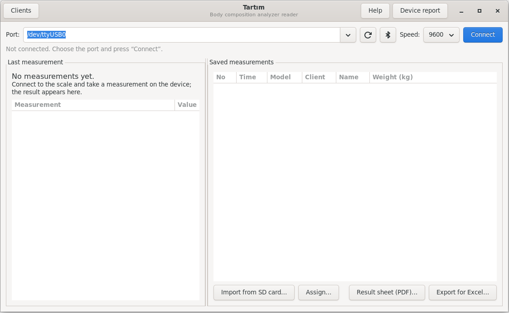

In the window:

- **Top:** port selection, refresh and Bluetooth buttons, speed and **Connect**
- **Left:** the results of the last measurement
- **Right:** saved measurements, **Import from SD card**, **Assign**, **Result sheet (PDF)** and **Export for Excel**
- **Top left:** **Clients** (see [Client records](#6-client-records))
- **Top right:** **Help** (this guide) and **Device report**

---

## 3. Connecting the scale with a cable

1. Connect the scale to the computer with a USB or RS-232 cable (with a
   USB-serial adapter) and turn the scale on.
2. In Tartım, press the **refresh** button (circular arrow).
3. Choose the scale in the **Port** list. Devices connected over USB usually
   appear as `/dev/ttyUSB0` or `/dev/ttyACM0` at the top of the list.
4. Leave **Speed** at 9600. Only change it if no data arrives (see
   [Troubleshooting](#9-troubleshooting)).
5. Press **Connect**. The button turns into a red **Disconnect** and the line
   below says "Listening on".

---

## 4. Connecting the scale over Bluetooth

Your computer must have Bluetooth and it must be on (check the system menu in
the top-right corner of the screen).

### 4.1 Finding the scale

1. Turn the scale on. If your device has a Bluetooth or pairing mode, switch it
   on (see the device's own manual).
2. In Tartım, press the **Bluetooth** button next to the port field.
3. Wait about 10 seconds. The devices found are added to the top of the **Port**
   list as `bt:...  (device name, type)`.
4. Open the list and choose your scale.

   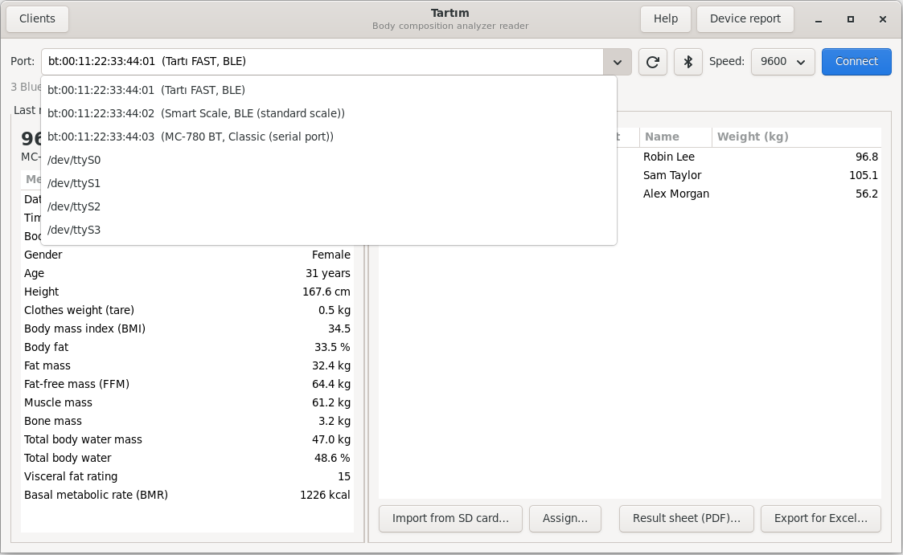

5. Press **Connect**. When the connection is made, the line below says "connected":

   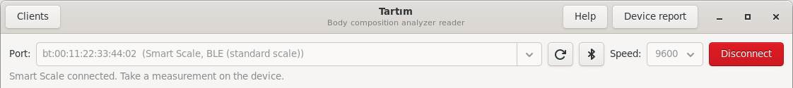

Next to each device the list shows one of three types:

| Shown | Meaning | What should I do? |
|---|---|---|
| **BLE (standard scale)** | The device uses the standard Bluetooth scale service. | Press **Connect**. Measurements arrive live. |
| **Classic (serial port)** | The device uses older Bluetooth that works like a cable. | Pair it first (4.2), then press **Connect**. |
| **BLE** | The device uses a vendor-specific method. | It cannot be read directly yet. Please send a **device report** (section 8); with it we can add support. |

### 4.2 Pairing a classic Bluetooth device

You do this once per device.

1. Open **Settings → Bluetooth**.
2. Click your scale in the list.
3. If a PIN is asked, enter the code from the device's manual. If the manual
   does not say, it is usually **0000** or **1234**.
4. When you see "Connected" or "Paired", return to Tartım, press the Bluetooth
   button again, choose the device and press **Connect**.

### 4.3 The Bluetooth device does not appear

- Make sure the scale is on and close to the computer (within a few metres).
- If the scale is connected to a phone or tablet, switch Bluetooth off on that
  device; most scales connect to one device at a time.
- Press the Bluetooth button once more; some devices only appear on the second scan.

---

## 5. Taking measurements

1. While connected (the line below says "Listening on" or "connected"), measure
   on the device as usual: enter the client number and details on the device
   and let the client step on. The number links the measurement to the
   client's record (see [Client records](#6-client-records)).
2. When the measurement ends, the result appears on the left of Tartım within a
   few seconds and is saved automatically. You do not need to do anything else.

   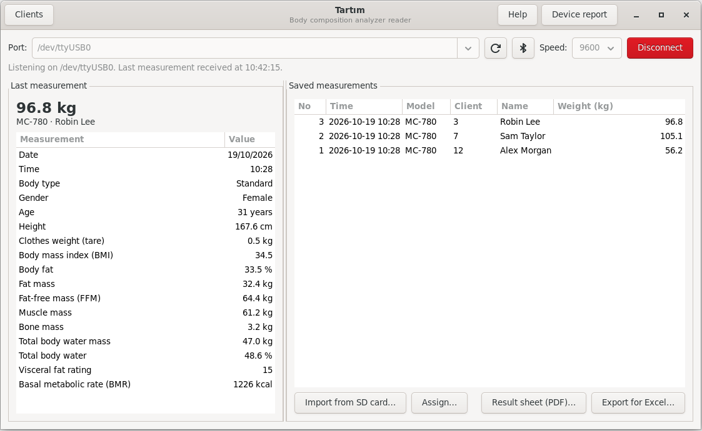
3. Continue the same way with the next client. There is no need to disconnect.
4. When you are done, press **Disconnect** or close the window.

> If you see an asterisk (*) next to a value: the meaning of that field has not
> been verified on a real device yet. Compare it with the value on the device
> display and send a device report if they differ.

---

## 6. Client records

Once you record your clients, measurements are listed with their names and you
no longer need to type the name for the result sheet.

**Adding a client:**

1. Press **Clients** at the top left.

   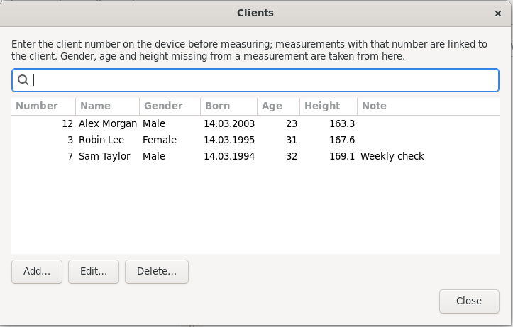

2. Press **Add…** and fill in the details:

   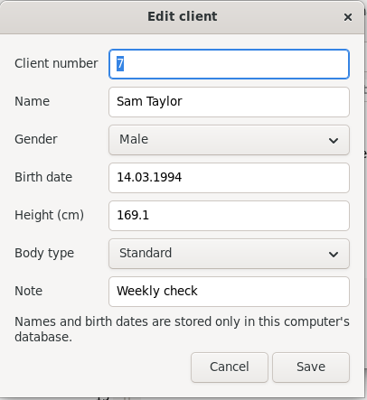

   - **Client number:** the number (ID) you enter on the device before measuring.
     Required.
   - **Name:** required.
   - **Gender, birth date, height, body type:** optional. Type the birth date as
     `01.05.1977`; the age is calculated for the date of each measurement.
   - **Note:** an optional short note.
3. Press **Save**.

**How are measurements linked to a client?** Enter the client number on the
device before measuring. The device sends the number with the measurement and
Tartım links the measurement to that client; the name appears in the **Name**
column of the saved measurements. Measurements saved earlier show the name as
soon as the client is added.

**Measurements without a number** (e.g. from Bluetooth scales that do not ask
for a client number, or when no number was entered): select the measurement in
the list, press **Assign…** and choose the client. Choose **(no client)** in the
same window to remove the link.

**Filling in missing details:** if the device does not send the gender, age or
height (some Bluetooth scales only send the weight), the assessments on the
result sheet take them from the client record, and the sheet says so. Values
sent by the device always take precedence. The body composition (fat, muscle,
water) is still calculated by the device; Tartım does not recalculate it.

**Editing and deleting:** select the client and press **Edit…** or **Delete…**.
If you change the client number, the client's measurements move to the new
number. When deleting, you can keep the measurements without the name or delete
them too.

From the command line:

```
tartim client add 42 --name "First Last" --gender female --birth 01.05.1980 --height 165
tartim client list
tartim client edit 42 --note "Weekly check"
tartim assign --record 12 --client 42
```

---

## 7. Saved measurements, SD card, Excel and the result sheet

**A saved measurement:** click a row in the list on the right; its details
appear on the left. Click the column headers to sort.

**Importing from an SD card** (for devices with an SD card):

1. Put the device's SD card into the computer.
2. Press **Import from SD card…**.
3. Choose the `.CSV` files on the card (you can choose several) and press **Import**.
4. The same measurement is never added twice; importing the same files again is fine.

**Exporting for Excel:**

1. Press **Export for Excel…**.
2. Give the file a name and press **Save**.
3. Open the file with LibreOffice Calc or Excel.

**Result sheet (PDF):** a printable result page you can hand to the client.

1. Select the measurement in the list on the right (without a selection the
   latest measurement is used).
2. Press **Result sheet (PDF)…**.
3. For a recorded client the name is filled in. Otherwise you can type it
   here; it is only printed on the sheet, not saved. Press **Create PDF**.
4. Give the file a name and press **Save**. The PDF opens; print it from there.

The first page analyses the measurement: body composition, segmental muscle and
fat distribution, metabolism, a low/normal/high assessment of BMI, body fat,
body water and visceral fat, the ideal weight range and a mass analysis. If the
client has more than one measurement, the second page shows a **difference
analysis** table and a **progress chart**.

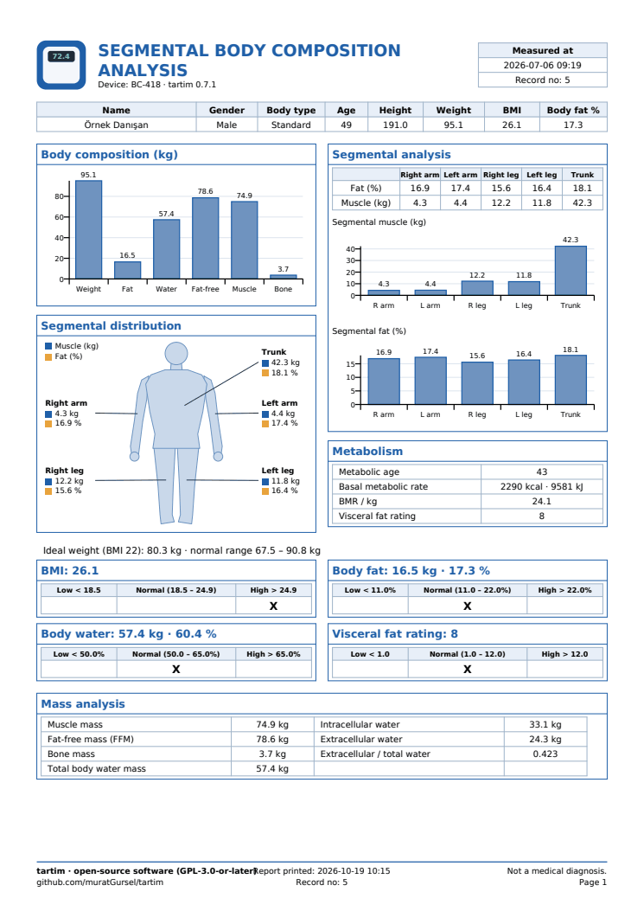

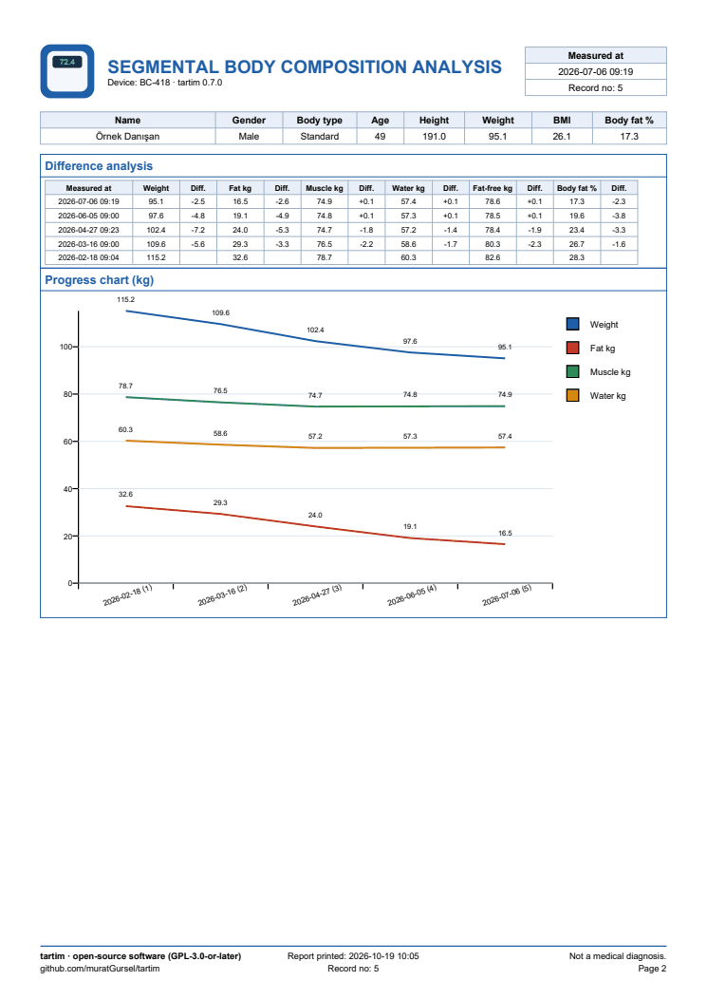

> The assessment uses published reference ranges: the World Health Organization
> for BMI, Gallagher et al. (2000) by gender and age for body fat, and the ranges
> Tanita publishes for body water and visceral fat. The sheet is not a medical
> diagnosis.

From the command line: `tartim print --name "First Last"` (latest measurement)
or `tartim print --record 12`.

---

## 8. Preparing and sending a device report

A device report teaches us how your scale sends its data to the computer. It is
especially helpful when:

- your scale does not show up in Tartım at all or "Unrecognized record" appears,
- the Bluetooth list shows only **BLE** next to your scale,
- the values shown differ from the device display.

A report takes about 2 minutes.

> **Important:** for a report, measure **yourself or a test person**. Do not use
> a real client's measurement. The client number is removed automatically, but
> age, height, gender and body values stay in the report.

### 7.1 Preparing the report

1. For a wired connection, first choose the scale in the **Port** list.
2. Press **Device report** in the top right.
3. Type the model in **Device model**. The model is printed on the label under
   or behind the device (e.g. `MC-780MA`, `FAST`).

   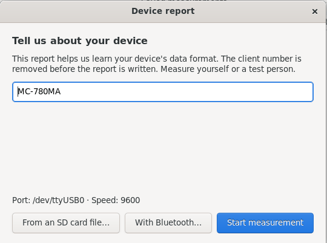
4. Press the button for your connection:
   - **Start measurement:** the scale is connected with a cable
   - **With Bluetooth…:** the scale has Bluetooth. Choose your scale in the list
     and press **Choose and start measuring**.

     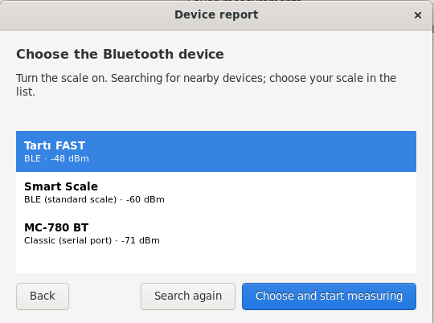
   - **From an SD card file…:** the device writes measurements to an SD card.
     Choose the file on the card.
5. When "Take a measurement on the device now" appears, measure on the scale.
   When data arrives the window moves to the next step by itself.

   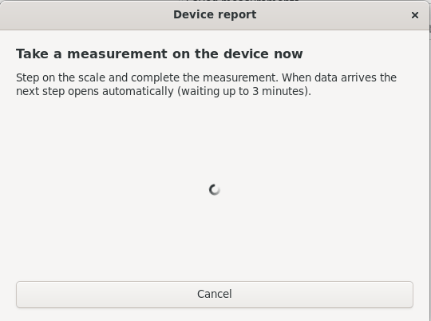

6. Type the **weight** shown on the device display (e.g. `72.4`). This is
   optional but makes verifying the data much easier.

   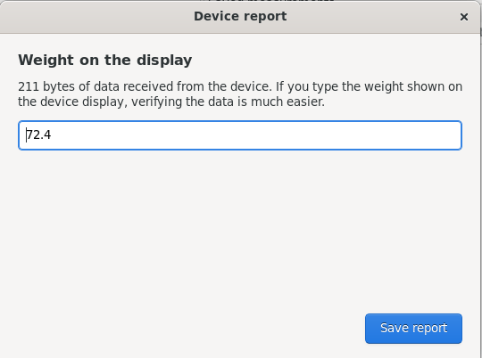

7. Press **Save report**. The report is saved in your **Documents** folder as
   `tartim-report-MODEL-DATE.json` and the send options appear (see 7.2).

Even if "No data arrived" is shown, save and send the report; that helps too.

### 7.2 Sending the report

After the report is saved, the window asks how you would like to send it.
Choose what suits you:

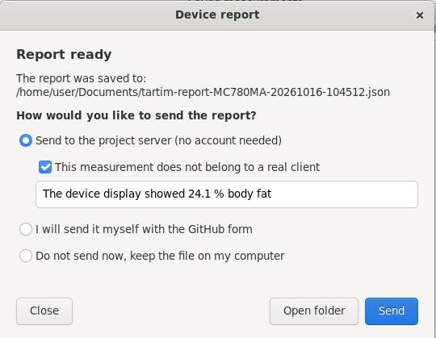

| Option | What happens? | For whom? |
|---|---|---|
| **Send to the project server** | The report reaches the developers with one click. No GitHub account needed. The report is not published. | The easiest for most users |
| **I will send it myself with the GitHub form** | The GitHub form opens and you attach the file. The issue is public. | People with a GitHub account who want to follow up themselves |
| **Do not send now** | The file stays on your computer. Send it whenever and however you like (e.g. by e-mail). | Organisations that want to check it internally first |

#### Sending to the project server

1. Keep **Send to the project server** selected.
2. Tick **"This measurement does not belong to a real client"**. Without it the
   **Send** button does not work.
3. Optionally write a short note (e.g. "The device display showed 24.1 % body fat").
4. Press **Send**. "Sent, thank you!" and a **report number** appear. Mention this
   number if you contact us.

Without an internet connection "Could not reach the report server" appears. The
file stays on your computer; you can send it again later (see 7.3).

#### Sending with the GitHub form

A free GitHub account is needed (<https://github.com/signup>).

1. Choose **I will send it myself with the GitHub form** and press
   **Open the GitHub form**. (Direct address:
   <https://github.com/muratGursel/tartim/issues/new?template=cihaz-raporu.yml>)
2. Sign in with your GitHub account. The "Device report" form opens:

   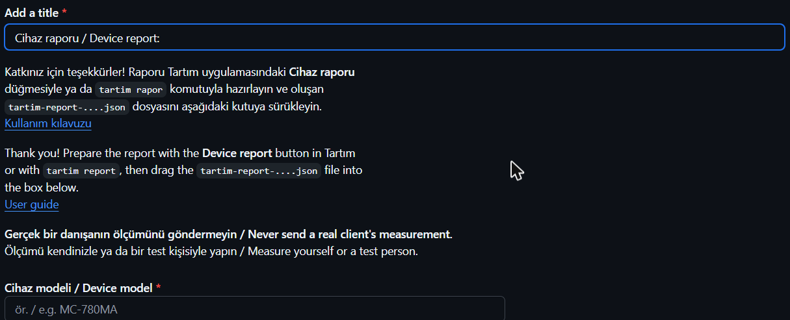

3. In the form:
   - **Device model:** type the model.
   - **Report file:** drag the `tartim-report-....json` file from the folder
     opened with **Open folder** into this box. When it is uploaded, a link
     appears in the box.

     

   - **Notes:** any problems you had (optional).
   - **Confirmation:** tick "This measurement does not belong to a real client"
     at the bottom of the page.
4. Press the green **Create** button at the bottom right.

Reports sent this way are public.

### 7.3 Reports from the command line (optional)

If you prefer the terminal to the interface:

```
tartim report               # wired device
tartim report --bluetooth   # Bluetooth device
tartim report --file /media/USER/SD/20261016.CSV   # SD card
```

It only asks for the model and the weight on the display, saves the report in
the current folder and asks how you would like to send it. To send a saved
report to the server later:

```
tartim send-report tartim-report-MC780MA-20261016-104512.json
```

---

## 9. Troubleshooting

| Problem | Solution |
|---|---|
| The port list is empty | Unplug and plug the cable back in and press **refresh**. If you use a USB-serial adapter, make sure it is plugged in. |
| "You do not have permission to use the port" | Log out and back in. If it persists and the port is `/dev/ttyS...`, run `sudo usermod -aG dialout $USER` in a terminal and log in again. |
| Connected but no measurement arrives | 1) Check that "data output to PC" is on in the device settings. 2) Press **Disconnect**, set **Speed** to 4800, 19200 or 38400 and try again. 3) If still nothing arrives, send a device report. |
| "Unrecognized record" | We do not know your device's format yet. Please send a device report. |
| "Bluetooth is off" | Turn Bluetooth on in the system menu. |
| "No Bluetooth adapter found" | The computer has no Bluetooth or it is disabled. You can plug in a USB Bluetooth adapter. |
| Could not connect over Bluetooth | The scale may be connected to a phone; switch Bluetooth off on that device. Pair classic devices first (4.2). |
| "This device does not use the standard Bluetooth scale service" | The device uses a vendor-specific method. Send a device report (8). |

If your problem is not solved, write to us at
<https://github.com/muratGursel/tartim/issues>.

---

## 10. Protecting personal data

Body measurements are health data, a special category of personal data under
KVKK and the GDPR.

- Measurements are stored only on your computer, in a file that only your user
  account can read (`~/.local/share/tartim/tartim.db`). Measurements are never
  sent to the internet. Client records (name, birth date, height, note) are
  kept in the same file and are never sent either.
- The only thing that goes to the internet is a **device report** that you choose
  and confirm. Reports sent to the project server are kept in a private
  repository that only the developers can access; reports sent with the GitHub
  form are public. In both cases, never send a real client's measurement.
- If your organisation wants to switch off sending to a server completely, the
  IT department can set the `TARTIM_REPORT_URL` environment variable to an empty
  value; the option then disappears from the window.
- Files exported for Excel contain personal data too; keep them in a safe place.
- Before using the application in your organisation, settle consent, access
  rights and retention with your data controller.
